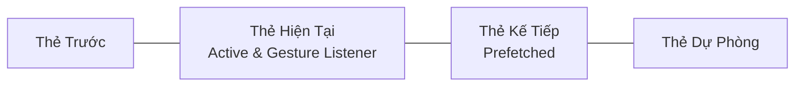

# ARCHITECTURE — Sakura Swipe Learning System Architecture

## 1. Tổng Quan Kiến Trúc Monorepo

Hệ thống được tổ chức theo mô hình Monorepo (sử dụng NPM Workspaces), đảm bảo việc chia sẻ kiểu dữ liệu (Types), DTO và Schema kiểm thực giữa Frontend và Backend mà không làm tăng độ phức tạp không cần thiết.

```
/ (Project Root)
├── apps/
│   ├── web/                     # Client Web App (Mobile-first, Vite, React, TailwindCSS)
│   ├── admin/                   # Bảng điều khiển Quản trị viên (Vite, React, TailwindCSS)
│   └── api/                     # REST API Service (Node.js, Express, TypeScript, MySQL)
├── packages/
│   └── shared/                  # Package dùng chung (DTOs, Validation Schemas, Enums)
├── docs/                        # Tài liệu dự án và bộ nhớ AI
├── package.json                 # Cấu hình NPM Workspaces
├── tsconfig.base.json           # Cấu hình TypeScript chia sẻ
└── .gitignore
```

---

## 2. Kiến Trúc Backend: Phân Lớp Chặt Chẽ (Layered Architecture)

Mọi yêu cầu HTTP gửi đến `apps/api` đều phải đi qua luồng tuần tự nghiêm ngặt, tuân thủ nguyên tắc Single Responsibility:

```
[ Client Request ]
       │
       ▼
 [ Express Router ]          (Định tuyến URL, gắn Middleware)
       │
       ▼
 [ Middleware Layer ]        (Auth JWT, Rate-limit, Zod Request Validator)
       │
       ▼
 [ Controller Layer ]        (Trích xuất params/body, gọi Service, trả HTTP Response)
       │
       ▼
  [ Service Layer ]          (Business Logic, Thuật toán SRS, Feed Engine, Transactions)
       │
       ▼
 [ Repository Layer ]        (Truy vấn MySQL, SQL Queries / ORM, Data Mapping)
       │
       ▼
 [ Database (MySQL 8) ]      (Persistence với Foreign Keys & Ràng buộc toàn vẹn)
```

### Các quy tắc bất khả xâm phạm:
1. **Controller** tuyệt đối không được gọi trực tiếp `Repository` và không bao giờ được thực thi SQL query.
2. **Repository** chỉ tập trung vào việc đọc/ghi dữ liệu từ Database, không chứa logic nghiệp vụ hay tính toán điểm số người dùng.
3. **Service** là nơi duy nhất chứa logic nghiệp vụ. Khi một thao tác ảnh hưởng đến nhiều bảng (ví dụ: người dùng trả lời câu hỏi -> cập nhật lịch sử -> tính lại điểm SRS -> tăng kinh nghiệm), Service phải quản lý Database Transaction để đảm bảo tính nguyên tử (Atomicity).

---

## 3. Kiến Trúc Frontend: Cơ Chế Thẻ Vuốt (Swipe Feed Architecture)

### 3.1. Bộ đệm thẻ học (Sliding Window Buffer)
Để đảm bảo trải nghiệm 60fps mượt mà trên các thiết bị di động cấu hình yếu, Frontend **không render toàn bộ danh sách thẻ** vào DOM, mà sử dụng cơ chế cửa sổ trượt (Sliding Window):

- **Buffer Size**: Duy trì tối đa 3-5 thẻ trong DOM cùng một lúc:
  - 1 Thẻ trước đó (`previous card` - phục vụ vuốt ngược xuống).
  - 1 Thẻ hiện tại (`active card` - nhận tương tác chạm/vuốt chính).
  - 2 Thẻ tiếp theo (`prefetch queue` - đã tải sẵn nội dung và hình ảnh để khi vuốt lên là hiển thị tức thì).
- Khi người dùng vuốt sang thẻ mới, thẻ cũ nhất sẽ được unmount khỏi DOM, và một thẻ mới sẽ được nạp ngầm từ bộ nhớ cache hoặc gọi API `/api/v1/feed/next`.



### 3.2. Xử lý Cử Chỉ & Không Xung Đột (Gesture Handling)
- Sử dụng cảm biến cử chỉ Touch (Touchstart, Touchmove, Touchend) với cơ chế xác định hướng di chuyển chính (Direction Lock):
  - Nếu góc di chuyển nằm trong khoảng trục dọc (Y-axis > X-axis), khóa cuộn ngang để tránh kích hoạt nhầm tính năng "Đã biết / Cần học lại".
  - Nếu góc di chuyển nằm trong khoảng trục ngang (X-axis > Y-axis), khóa trượt dọc để người dùng thực hiện thao tác đánh giá thẻ.
- Đối với thẻ câu hỏi: Cử chỉ vuốt ngang bị vô hiệu hóa hoàn toàn, chỉ mở khóa vuốt dọc sau khi đã hoàn tất bước trả lời.

---

## 4. Thuật Toán Phân Phối Nội Dung (Smart Feed & SRS Engine)

Thuật toán phân phối thẻ học được tách biệt thành một Service độc lập (`FeedEngineService`), cho phép dễ dàng cấu hình hoặc thay đổi thuật toán mà không ảnh hưởng đến các tầng khác.

### 4.1. Tỷ lệ phân bổ nội dung (Content Distribution Ratio)
Trong một phiên học thông thường, luồng thẻ được sinh ra dựa trên tỷ lệ cấu hình:
- **60% Kiến thức mới (New Items)**: Thuộc cấp độ JLPT mà người dùng đang hướng tới, chưa từng học.
- **30% Ôn tập ngắt quãng (SRS Review Items)**: Các kiến thức đã đến hạn ôn tập (Due Review) dựa trên thuật toán SM-2 rút gọn.
- **10% Củng cố điểm yếu (Weak Points / Questions)**: Các câu hỏi trắc nghiệm hoặc bài tập liên quan đến những thẻ mà người dùng từng bấm "Cần học lại" trong các phiên gần nhất.

### 4.2. Nguyên tắc chống nhàm chán (Anti-Fatigue Rules)
- Không bao giờ hiển thị 2 thẻ câu hỏi liên tiếp nhau.
- Không lặp lại cùng một Kanji/Từ vựng trong phạm vi 10 thẻ gần nhất.
- Nếu người dùng chuyển cấp độ JLPT trong cài đặt, hàng đợi thẻ sẽ tự động được làm mới (Re-seed Feed).

---

## 5. Cơ Chế Idempotency & Chống Trùng Lặp Tiến Trình (Progress Sync)

Khi người dùng học trên điện thoại, các vấn đề như mạng chập chờn, rớt gói tin hoặc bấm liên tục có thể xảy ra:
1. Mỗi thao tác đánh giá thẻ hoặc trả lời câu hỏi đều được client gắn một `clientEventId` duy nhất (UUID v4).
2. Khi gửi request cập nhật tiến trình (`POST /api/v1/progress/event`), Server kiểm tra `clientEventId` trong bảng `learning_events`:
   - Nếu đã tồn tại: Bỏ qua bước tính toán lại và trả về kết quả đã xử lý trước đó (Idempotent response).
   - Nếu chưa tồn tại: Thực thi Service ghi nhận trong Transaction.
