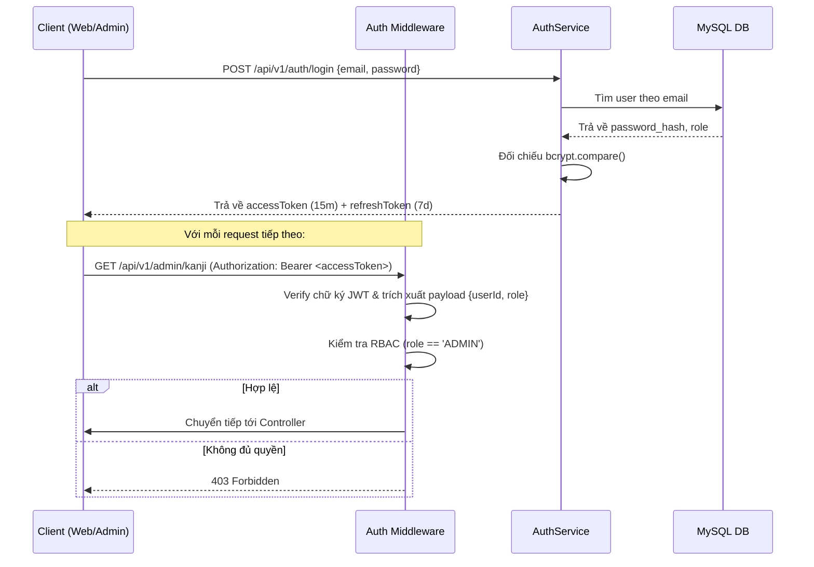
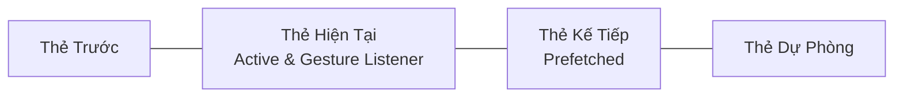
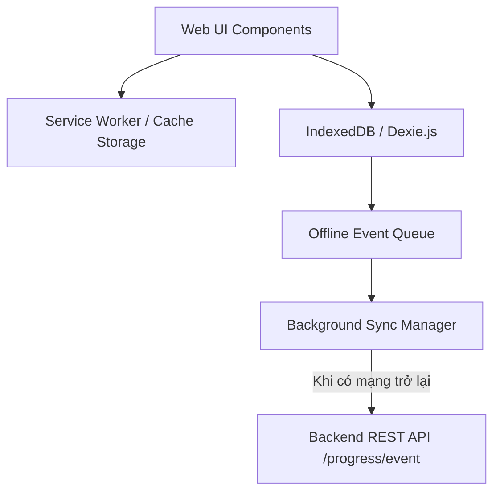

# ARCHITECTURE — Sakura Swipe Learning System Architecture

## 1. Tổng Quan Kiến Trúc Monorepo

Hệ thống được tổ chức theo mô hình Monorepo (sử dụng NPM Workspaces), đảm bảo việc chia sẻ kiểu dữ liệu (Types), DTO và Schema kiểm thực giữa Frontend và Backend mà không làm tăng độ phức tạp không cần thiết.

```
/ (Project Root)
├── apps/
│   ├── web/                     # Client Web App (Mobile-first, Vite, React, TailwindCSS)
│   ├── admin/                   # Bảng điều khiển Quản trị viên (Vite, React, TailwindCSS)
│   └── api/                     # REST API Service (Node.js, Express, TypeScript, MySQL)
├── packages/
│   └── shared/                  # Package dùng chung (DTOs, Validation Schemas, Enums)
├── docs/                        # Tài liệu dự án và bộ nhớ AI
├── package.json                 # Cấu hình NPM Workspaces
├── tsconfig.base.json           # Cấu hình TypeScript chia sẻ
└── .gitignore
```

### Trách nhiệm của các package:

- `apps/web`: Ứng dụng di động trên nền web dành cho học viên, tối ưu giao diện vuốt 60fps, hỗ trợ PWA offline.
- `apps/admin`: Cổng quản trị dành cho giáo viên và người kiểm duyệt nội dung (Kanji, Từ vựng, Ngữ pháp, Câu hỏi).
- `apps/api`: REST API backend chịu trách nhiệm xử lý toàn bộ logic nghiệp vụ, thuật toán feed và lưu trữ dữ liệu.
- `packages/shared`: Nơi lưu trữ các Zod schemas, TypeScript types, DTO contracts và hằng số enum để đảm bảo Type-safety từ Client đến Server.

---

## 2. Kiến Trúc Backend: 6 Tầng Tách Biệt Nghiêm Ngặt

Mọi yêu cầu HTTP gửi đến `apps/api` đều phải đi qua luồng tuần tự nghiêm ngặt, tuân thủ nguyên tắc Single Responsibility:

```
[ Client HTTP Request ]
       │
       ▼
 [ 1. Router Layer ]            (Định nghĩa URL, HTTP Method, gắn Middleware)
       │
       ▼
 [ 2. Validation & Middleware ] (Xác thực JWT Token, RBAC Guard, Zod Schema Validator)
       │
       ▼
 [ 3. Controller Layer ]        (Bóc tách Request DTO, điều hướng Service, trả JSON Response)
       │
       ▼
 [ 4. Service Layer ]           (Business Logic, Thuật toán SRS, Feed Engine, Quản lý Transaction)
       │
       ▼
 [ 5. Repository Layer ]        (Thực thi truy vấn SQL qua Connection Pool, Data Mapping)
       │
       ▼
 [ 6. Model & Database ]        (Entity Models, Bảng MySQL 8 với ràng buộc toàn vẹn dữ liệu)
```

### Chi tiết trách nhiệm từng tầng:

1. **Router**: Chỉ khai báo định tuyến đường dẫn HTTP (`/api/v1/feed`), phương thức (`GET/POST`), và gắn các middleware (như `authenticate`, `requireRole('ADMIN')`, `validateBody(createKanjiSchema)`). Tuyệt đối không chứa logic nghiệp vụ.
2. **Validation & Middleware**: Đảm bảo request body/query hợp lệ trước khi vào Controller. Nếu sai format, reject ngay lập tức với mã lỗi `400 Bad Request`.
3. **Controller**: Nhận request đã được validate, chuyển đổi thành DTO sạch, gọi phương thức Service tương ứng và định dạng kết quả trả về `res.status(200).json(...)`. **Quy tắc bất biến: Controller không gọi Repository trực tiếp và không truy cập database.**
4. **Service**: Trung tâm của toàn bộ Business Logic. Xử lý thuật toán SRS, tính điểm kinh nghiệm (EXP), điều phối nhiều Repository trong một Database Transaction (Atomic Unit of Work).
5. **Repository**: Chịu trách nhiệm trực tiếp giao tiếp với cơ sở dữ liệu MySQL bằng Parameterized SQL queries. Không chứa logic nghiệp vụ.
6. **Model**: Định nghĩa các kiểu thực thể dữ liệu ánh xạ 1-1 với cấu trúc bảng trong MySQL.

---

## 3. Xác Thực & Phân Quyền (Authentication & Authorization)

Hệ thống sử dụng cơ chế **Stateless JWT** kết hợp **Role-Based Access Control (RBAC)**:



---

## 4. Kiến Trúc Frontend: Cơ Chế Thẻ Vuốt (Swipe Feed Architecture)

### 4.1. Bộ đệm thẻ học (Sliding Window Buffer)

Để đảm bảo trải nghiệm 60fps mượt mà trên các thiết bị di động cấu hình yếu, Frontend **không render toàn bộ danh sách thẻ** vào DOM, mà sử dụng cơ chế cửa sổ trượt (Sliding Window):

- **Buffer Size**: Duy trì tối đa 3-5 thẻ trong DOM cùng một lúc:
  - 1 Thẻ trước đó (`previous card` - phục vụ vuốt ngược xuống).
  - 1 Thẻ hiện tại (`active card` - nhận tương tác chạm/vuốt chính).
  - 2 Thẻ tiếp theo (`prefetch queue` - đã tải sẵn nội dung và hình ảnh để khi vuốt lên là hiển thị tức thì).
- Khi người dùng vuốt sang thẻ mới, thẻ cũ nhất sẽ được unmount khỏi DOM, và một thẻ mới sẽ được nạp ngầm từ bộ nhớ cache hoặc gọi API `/api/v1/feed/next`.



### 4.2. Xử lý Cử Chỉ & Không Xung Đột (Gesture Handling)

- Sử dụng cảm biến cử chỉ Touch (Touchstart, Touchmove, Touchend) với cơ chế xác định hướng di chuyển chính (Direction Lock):
  - Nếu góc di chuyển nằm trong khoảng trục dọc (Y-axis > X-axis), khóa cuộn ngang để tránh kích hoạt nhầm tính năng "Đã biết / Cần học lại".
  - Nếu góc di chuyển nằm trong khoảng trục ngang (X-axis > Y-axis), khóa trượt dọc để người dùng thực hiện thao tác đánh giá thẻ.
- Đối với thẻ câu hỏi: Cử chỉ vuốt ngang bị vô hiệu hóa hoàn toàn, chỉ mở khóa vuốt dọc sau khi đã hoàn tất bước trả lời.

---

## 5. Thuật Toán Phân Phối Nội Dung (Smart Feed & SRS Engine)

Thuật toán phân phối thẻ học được tách biệt thành một Service độc lập (`FeedEngineService`), cho phép dễ dàng cấu hình hoặc thay đổi thuật toán mà không ảnh hưởng đến các tầng khác.

### 5.1. Tỷ lệ phân bổ nội dung (Content Distribution Ratio)

Trong một phiên học thông thường, luồng thẻ được sinh ra dựa trên tỷ lệ cấu hình:

- **60% Kiến thức mới (New Items)**: Thuộc cấp độ JLPT mà người dùng đang hướng tới, chưa từng học.
- **30% Ôn tập ngắt quãng (SRS Review Items)**: Các kiến thức đã đến hạn ôn tập (Due Review) dựa trên thuật toán SM-2 rút gọn.
- **10% Củng cố điểm yếu (Weak Points / Questions)**: Các câu hỏi trắc nghiệm hoặc bài tập liên quan đến những thẻ mà người dùng từng bấm "Cần học lại" trong các phiên gần nhất.

### 5.2. Công thức thuật toán Lặp lại ngắt quãng (Spaced Repetition SM-2)

- Khi người dùng đánh giá "Đã nhớ" hoặc làm đúng câu hỏi:
  - `srs_stage = srs_stage + 1`
  - Khoảng cách ôn tập tiếp theo:
    - Stage 1: 4 giờ
    - Stage 2: 8 giờ
    - Stage 3: 24 giờ (1 ngày)
    - Stage 4: 3 ngày
    - Stage 5: 7 ngày
    - Stage 6: 14 ngày
    - Stage 7: 30 ngày
    - Stage 8: 120 ngày (Mastered/Burned)
- Khi người dùng đánh giá "Cần học lại" hoặc làm sai câu hỏi:
  - `srs_stage = Math.max(1, srs_stage - 2)`
  - `next_review_at = NOW() + 4 giờ`

---

## 6. Kiến Trúc Hỗ Trợ Ngoại Tuyến (PWA & Offline Architecture)

Để đảm bảo học tập mượt mà ngay cả trên tàu điện ngầm hoặc khu vực mất sóng:



1. **Service Worker**: Cache toàn bộ static assets (HTML, CSS, JS, Fonts Noto Sans JP, Icon hoa anh đào) theo chiến lược `Stale-While-Revalidate`.
2. **IndexedDB (Dexie.js)**: Lưu trữ bộ đệm 50 thẻ học offline sẵn sàng cho phiên học hiện tại.
3. **Offline Event Queue**: Khi mất kết nối mạng, các thao tác vuốt và câu trả lời vẫn được ghi nhận tức thì vào IndexedDB kèm `clientEventId`. Ngay khi có mạng trở lại, Background Sync sẽ đồng bộ tuần tự lên Server mà không làm gián đoạn trải nghiệm của học viên.

---

## 7. Xử Lý Lỗi, Ghi Log & Giám Sát (Error Handling & Logging)

- **Centralized Error Handling**: Mọi lỗi trong Express đều được bắt qua `ErrorHandlerMiddleware`. Lỗi hệ thống nội bộ trả về mã 500 kèm mã trace ID để tra cứu mà không làm lộ stack trace ra phía client.
- **Structured JSON Logging**: Sử dụng thư viện `winston` ghi log định dạng JSON có chứa timestamp, log level, request ID, user ID và thời gian xử lý request (durationMs).
- **Test Strategy**: Unit test cho Service logic; Integration test qua Supertest cho API Endpoints; Component test cho React components; E2E test cho Critical Paths.
