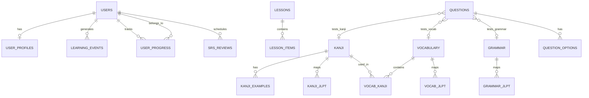

# DATABASE — Sakura Swipe Learning Database Design

## 1. Nguyên Tắc Thiết Kế Cơ Sở Dữ Liệu

1. **Chuẩn hóa dữ liệu (3NF)**: Tránh lưu trùng lặp dữ liệu có thể tính toán hoặc liên kết bằng khóa ngoại.
2. **Quan hệ đa hình & đa cấp độ**:
   - Một chữ Kanji hay Từ vựng có thể xuất hiện trong nhiều cấp độ JLPT hoặc bài học khác nhau (sử dụng bảng nối Many-to-Many).
   - Phân biệt rõ: **Cấp độ JLPT của kiến thức** (N5-N1), **Cấp độ kinh nghiệm của người dùng** (User Level / EXP), và **Mức độ thành thạo kiến thức** (SRS Stage / Mastery Score).
3. **Tính toàn vẹn dữ liệu (Data Integrity)**:
   - Sử dụng triệt để khóa ngoại (`FOREIGN KEY`) với các hành vi `ON DELETE CASCADE` hoặc `ON DELETE RESTRICT` phù hợp.
   - Bắt buộc kiểm tra ràng buộc duy nhất (`UNIQUE KEY`) để chống trùng dữ liệu.
4. **Idempotency & Audit Trail**:
   - Mọi tương tác vuốt và trả lời câu hỏi đều được ghi nhận vào bảng `learning_events` với `client_event_id` (UUID) để ngăn chặn việc ghi trùng khi client gửi lại request.

---

## 2. Sơ Đồ Quan Hệ Thực Thể (Entity Relationship Diagram - ERD)



---

## 3. Chi Tiết Schema & Bảng Dữ Liệu (MySQL 8)

### 3.1. Nhóm Người Dùng & Hồ Sơ (Users & Profiles)

```sql
-- 1. Bảng tài khoản người dùng
CREATE TABLE `users` (
  `id` BIGINT UNSIGNED NOT NULL AUTO_INCREMENT,
  `email` VARCHAR(191) NOT NULL,
  `password_hash` VARCHAR(255) NOT NULL,
  `role` ENUM('USER', 'ADMIN', 'MODERATOR') NOT NULL DEFAULT 'USER',
  `is_active` BOOLEAN NOT NULL DEFAULT TRUE,
  `created_at` DATETIME NOT NULL DEFAULT CURRENT_TIMESTAMP,
  `updated_at` DATETIME NOT NULL DEFAULT CURRENT_TIMESTAMP ON UPDATE CURRENT_TIMESTAMP,
  PRIMARY KEY (`id`),
  UNIQUE KEY `uk_users_email` (`email`)
) ENGINE=InnoDB DEFAULT CHARSET=utf8mb4 COLLATE=utf8mb4_unicode_ci;

-- 2. Bảng hồ sơ chi tiết và mục tiêu học tập
CREATE TABLE `user_profiles` (
  `user_id` BIGINT UNSIGNED NOT NULL,
  `display_name` VARCHAR(100) NOT NULL,
  `avatar_url` VARCHAR(255) NULL,
  `target_jlpt` ENUM('N5', 'N4', 'N3', 'N2', 'N1') NOT NULL DEFAULT 'N5',
  `daily_goal_cards` INT UNSIGNED NOT NULL DEFAULT 20,
  `current_streak_days` INT UNSIGNED NOT NULL DEFAULT 0,
  `total_exp` BIGINT UNSIGNED NOT NULL DEFAULT 0,
  `new_cards_ratio` DECIMAL(3,2) NOT NULL DEFAULT 0.60, -- 60% thẻ mới
  `review_cards_ratio` DECIMAL(3,2) NOT NULL DEFAULT 0.30, -- 30% ôn tập
  `last_study_date` DATE NULL,
  `created_at` DATETIME NOT NULL DEFAULT CURRENT_TIMESTAMP,
  `updated_at` DATETIME NOT NULL DEFAULT CURRENT_TIMESTAMP ON UPDATE CURRENT_TIMESTAMP,
  PRIMARY KEY (`user_id`),
  CONSTRAINT `fk_user_profiles_user` FOREIGN KEY (`user_id`) REFERENCES `users` (`id`) ON DELETE CASCADE
) ENGINE=InnoDB DEFAULT CHARSET=utf8mb4 COLLATE=utf8mb4_unicode_ci;
```

### 3.2. Nhóm Nội Dung Học Tập Cốt Lõi (Content Core)

```sql
-- 3. Bảng Kanji
CREATE TABLE `kanji` (
  `id` BIGINT UNSIGNED NOT NULL AUTO_INCREMENT,
  `character` VARCHAR(10) NOT NULL,
  `han_viet` VARCHAR(100) NOT NULL,              -- Âm Hán Việt (ví dụ: NHẬT, NGUYỆT)
  `onyomi` VARCHAR(191) NOT NULL,                -- Phiên âm On (Katakana)
  `kunyomi` VARCHAR(191) NOT NULL,               -- Phiên âm Kun (Hiragana)
  `stroke_count` TINYINT UNSIGNED NOT NULL,      -- Số nét
  `radical` VARCHAR(10) NULL,                    -- Bộ thủ chính
  `meaning_vi` TEXT NOT NULL,                    -- Giải thích nghĩa tiếng Việt
  `status` ENUM('DRAFT', 'PUBLISHED', 'ARCHIVED') NOT NULL DEFAULT 'PUBLISHED',
  `created_at` DATETIME NOT NULL DEFAULT CURRENT_TIMESTAMP,
  `updated_at` DATETIME NOT NULL DEFAULT CURRENT_TIMESTAMP ON UPDATE CURRENT_TIMESTAMP,
  PRIMARY KEY (`id`),
  UNIQUE KEY `uk_kanji_character` (`character`)
) ENGINE=InnoDB DEFAULT CHARSET=utf8mb4 COLLATE=utf8mb4_unicode_ci;

-- 4. Bảng liên kết Kanji với nhiều cấp độ JLPT
CREATE TABLE `kanji_jlpt` (
  `kanji_id` BIGINT UNSIGNED NOT NULL,
  `jlpt_level` ENUM('N5', 'N4', 'N3', 'N2', 'N1') NOT NULL,
  PRIMARY KEY (`kanji_id`, `jlpt_level`),
  CONSTRAINT `fk_kanji_jlpt_kanji` FOREIGN KEY (`kanji_id`) REFERENCES `kanji` (`id`) ON DELETE CASCADE
) ENGINE=InnoDB DEFAULT CHARSET=utf8mb4 COLLATE=utf8mb4_unicode_ci;

-- 5. Bảng ví dụ cho Kanji
CREATE TABLE `kanji_examples` (
  `id` BIGINT UNSIGNED NOT NULL AUTO_INCREMENT,
  `kanji_id` BIGINT UNSIGNED NOT NULL,
  `word` VARCHAR(100) NOT NULL,                  -- Từ vựng chứa Kanji đó
  `reading` VARCHAR(100) NOT NULL,               -- Cách đọc (Hiragana)
  `meaning_vi` VARCHAR(255) NOT NULL,            -- Nghĩa tiếng Việt
  `sentence_jp` TEXT NULL,                       -- Câu ví dụ tiếng Nhật
  `sentence_vi` TEXT NULL,                       -- Dịch nghĩa câu ví dụ
  `order_index` INT UNSIGNED NOT NULL DEFAULT 0,
  PRIMARY KEY (`id`),
  KEY `idx_kanji_examples_kanji_id` (`kanji_id`),
  CONSTRAINT `fk_kanji_examples_kanji` FOREIGN KEY (`kanji_id`) REFERENCES `kanji` (`id`) ON DELETE CASCADE
) ENGINE=InnoDB DEFAULT CHARSET=utf8mb4 COLLATE=utf8mb4_unicode_ci;

-- 6. Bảng Từ Vựng (Vocabulary)
CREATE TABLE `vocabulary` (
  `id` BIGINT UNSIGNED NOT NULL AUTO_INCREMENT,
  `word` VARCHAR(191) NOT NULL,
  `reading` VARCHAR(191) NOT NULL,               -- Hiragana / Katakana
  `romaji` VARCHAR(191) NULL,
  `part_of_speech` VARCHAR(50) NULL,             -- Noun, Verb-1, Verb-2, Adj-i...
  `meaning_vi` TEXT NOT NULL,
  `audio_url` VARCHAR(255) NULL,
  `status` ENUM('DRAFT', 'PUBLISHED', 'ARCHIVED') NOT NULL DEFAULT 'PUBLISHED',
  `created_at` DATETIME NOT NULL DEFAULT CURRENT_TIMESTAMP,
  `updated_at` DATETIME NOT NULL DEFAULT CURRENT_TIMESTAMP ON UPDATE CURRENT_TIMESTAMP,
  PRIMARY KEY (`id`),
  KEY `idx_vocab_word` (`word`),
  KEY `idx_vocab_reading` (`reading`)
) ENGINE=InnoDB DEFAULT CHARSET=utf8mb4 COLLATE=utf8mb4_unicode_ci;

-- 7. Bảng liên kết Từ vựng với cấp độ JLPT
CREATE TABLE `vocab_jlpt` (
  `vocab_id` BIGINT UNSIGNED NOT NULL,
  `jlpt_level` ENUM('N5', 'N4', 'N3', 'N2', 'N1') NOT NULL,
  PRIMARY KEY (`vocab_id`, `jlpt_level`),
  CONSTRAINT `fk_vocab_jlpt_vocab` FOREIGN KEY (`vocab_id`) REFERENCES `vocabulary` (`id`) ON DELETE CASCADE
) ENGINE=InnoDB DEFAULT CHARSET=utf8mb4 COLLATE=utf8mb4_unicode_ci;
```

### 3.3. Nhóm Ngân Hàng Câu Hỏi & Bài Tập (Question Engine)

```sql
-- 8. Bảng câu hỏi tương tác
CREATE TABLE `questions` (
  `id` BIGINT UNSIGNED NOT NULL AUTO_INCREMENT,
  `item_type` ENUM('KANJI', 'VOCABULARY', 'GRAMMAR', 'SENTENCE') NOT NULL,
  `item_id` BIGINT UNSIGNED NOT NULL,            -- ID của kiến thức mục tiêu
  `question_type` ENUM(
    'MULTIPLE_CHOICE',       -- Trắc nghiệm 4 lựa chọn
    'FILL_IN_BLANK',         -- Điền đáp án text
    'ORDER_WORDS',           -- Ghép câu theo thứ tự
    'MEANING_MATCH'          -- Nối nghĩa
  ) NOT NULL,
  `prompt` TEXT NOT NULL,                        -- Đề bài (tiếng Nhật hoặc tiếng Việt)
  `explanation_vi` TEXT NOT NULL,                -- Giải thích chi tiết vì sao đúng/sai
  `acceptable_answers` JSON NULL,                -- Mảng chuỗi chấp nhận cho dạng tự luận/điền
  `created_at` DATETIME NOT NULL DEFAULT CURRENT_TIMESTAMP,
  `updated_at` DATETIME NOT NULL DEFAULT CURRENT_TIMESTAMP ON UPDATE CURRENT_TIMESTAMP,
  PRIMARY KEY (`id`),
  KEY `idx_questions_item` (`item_type`, `item_id`)
) ENGINE=InnoDB DEFAULT CHARSET=utf8mb4 COLLATE=utf8mb4_unicode_ci;

-- 9. Bảng các lựa chọn cho câu hỏi trắc nghiệm
CREATE TABLE `question_options` (
  `id` BIGINT UNSIGNED NOT NULL AUTO_INCREMENT,
  `question_id` BIGINT UNSIGNED NOT NULL,
  `content` VARCHAR(255) NOT NULL,               -- Nội dung lựa chọn (text tiếng Nhật/Việt)
  `is_correct` BOOLEAN NOT NULL DEFAULT FALSE,
  `order_index` TINYINT UNSIGNED NOT NULL DEFAULT 0,
  PRIMARY KEY (`id`),
  KEY `idx_options_question_id` (`question_id`),
  CONSTRAINT `fk_question_options_q` FOREIGN KEY (`question_id`) REFERENCES `questions` (`id`) ON DELETE CASCADE
) ENGINE=InnoDB DEFAULT CHARSET=utf8mb4 COLLATE=utf8mb4_unicode_ci;
```

### 3.4. Nhóm Tiến Trình Học Tập & SRS (Progress & Idempotent Events)

```sql
-- 10. Bảng lưu trữ trạng thái tiến trình của từng học viên trên từng kiến thức
CREATE TABLE `user_progress` (
  `id` BIGINT UNSIGNED NOT NULL AUTO_INCREMENT,
  `user_id` BIGINT UNSIGNED NOT NULL,
  `item_type` ENUM('KANJI', 'VOCABULARY', 'GRAMMAR', 'SENTENCE') NOT NULL,
  `item_id` BIGINT UNSIGNED NOT NULL,
  `status` ENUM('NEW', 'LEARNING', 'REVIEW_DUE', 'MASTERED') NOT NULL DEFAULT 'NEW',
  `consecutive_correct` INT UNSIGNED NOT NULL DEFAULT 0,
  `total_views` INT UNSIGNED NOT NULL DEFAULT 0,
  `total_correct` INT UNSIGNED NOT NULL DEFAULT 0,
  `total_incorrect` INT UNSIGNED NOT NULL DEFAULT 0,
  `srs_stage` TINYINT UNSIGNED NOT NULL DEFAULT 0,   -- Giai đoạn SRS (0 -> 8)
  `ease_factor` DECIMAL(4,2) NOT NULL DEFAULT 2.50, -- Hệ số SM-2
  `next_review_at` DATETIME NULL,                   -- Thời điểm ôn tập tiếp theo
  `last_reviewed_at` DATETIME NULL,
  `created_at` DATETIME NOT NULL DEFAULT CURRENT_TIMESTAMP,
  `updated_at` DATETIME NOT NULL DEFAULT CURRENT_TIMESTAMP ON UPDATE CURRENT_TIMESTAMP,
  PRIMARY KEY (`id`),
  UNIQUE KEY `uk_user_item` (`user_id`, `item_type`, `item_id`),
  KEY `idx_user_review_due` (`user_id`, `next_review_at`),
  CONSTRAINT `fk_user_progress_user` FOREIGN KEY (`user_id`) REFERENCES `users` (`id`) ON DELETE CASCADE
) ENGINE=InnoDB DEFAULT CHARSET=utf8mb4 COLLATE=utf8mb4_unicode_ci;

-- 11. Bảng sự kiện học tập (Chống trùng lặp Idempotency)
CREATE TABLE `learning_events` (
  `id` BIGINT UNSIGNED NOT NULL AUTO_INCREMENT,
  `client_event_id` VARCHAR(64) NOT NULL,          -- UUID tạo bởi client
  `user_id` BIGINT UNSIGNED NOT NULL,
  `item_type` ENUM('KANJI', 'VOCABULARY', 'GRAMMAR', 'QUESTION') NOT NULL,
  `item_id` BIGINT UNSIGNED NOT NULL,
  `action` ENUM(
    'SWIPE_RIGHT_KNOWN',     -- Đã biết / nhớ
    'SWIPE_LEFT_AGAIN',      -- Cần học lại
    'ANSWER_CORRECT',        -- Trả lời đúng câu hỏi
    'ANSWER_INCORRECT'       -- Trả lời sai câu hỏi
  ) NOT NULL,
  `payload` JSON NULL,                             -- Dữ liệu phụ (thời gian làm, câu trả lời)
  `created_at` DATETIME NOT NULL DEFAULT CURRENT_TIMESTAMP,
  PRIMARY KEY (`id`),
  UNIQUE KEY `uk_client_event_id` (`client_event_id`),
  KEY `idx_user_learning_history` (`user_id`, `created_at`),
  CONSTRAINT `fk_learning_events_user` FOREIGN KEY (`user_id`) REFERENCES `users` (`id`) ON DELETE CASCADE
) ENGINE=InnoDB DEFAULT CHARSET=utf8mb4 COLLATE=utf8mb4_unicode_ci;
```
