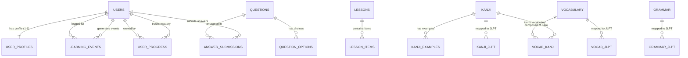

# DATABASE — Sakura Swipe Learning Database Design Specification

## 1. Nguyên Tắc Thiết Kế Cơ Sở Dữ Liệu

1. **Chuẩn hóa dữ liệu (3NF)**: Tránh lưu trùng lặp dữ liệu có thể tính toán hoặc liên kết bằng khóa ngoại.
2. **Quan hệ đa hình & đa cấp độ**:
   - Một chữ Kanji hay Từ vựng có thể xuất hiện trong nhiều cấp độ JLPT hoặc bài học khác nhau (sử dụng bảng nối Many-to-Many).
   - Phân biệt rõ: **Cấp độ JLPT của kiến thức** (N5-N1), **Cấp độ kinh nghiệm của người dùng** (User Level / EXP), và **Mức độ thành thạo kiến thức** (SRS Stage / Mastery Score).
3. **Tính toàn vẹn dữ liệu (Data Integrity)**:
   - Sử dụng triệt để khóa ngoại (`FOREIGN KEY`) với các hành vi `ON DELETE CASCADE` hoặc `ON DELETE RESTRICT` phù hợp.
   - Bắt buộc kiểm tra ràng buộc duy nhất (`UNIQUE KEY`) để chống trùng dữ liệu.
4. **Cơ chế Soft Delete (Xóa mềm)**:
   - Các bảng nội dung kiến thức (`kanji`, `vocabulary`, `grammar`, `sentences`, `lessons`, `questions`) sử dụng cột `deleted_at DATETIME NULL` để không làm đứt gãy lịch sử học tập của học viên khi quản trị viên gỡ bỏ nội dung.
5. **Idempotency & Audit Trail**:
   - Mọi tương tác vuốt và trả lời câu hỏi đều được ghi nhận vào bảng `learning_events` với `client_event_id` (UUID v4) và `UNIQUE KEY` để ngăn chặn việc ghi trùng khi client gửi lại request.
6. **Quy tắc Transaction (Nguyên tử - ACID)**:
   - Mọi nghiệp vụ cập nhật tiến trình (ghi nhận event -> cập nhật SRS `user_progress` -> cộng EXP `user_profiles` -> tính Streak) bắt buộc thực thi trong một Database Transaction duy nhất.

---

## 2. Danh Sách Các Thực Thể (Entity Catalog)

| Nhóm | Tên Thực Thể (Entity) | Mục Đích Nghiệp Vụ | Soft Delete |
| :--- | :--- | :--- | :--- |
| **Người dùng** | `users` | Lưu trữ tài khoản, mật khẩu băm, vai trò (Role: USER, ADMIN, MODERATOR). | Có |
| | `user_profiles` | Lưu thông tin hiển thị, mục tiêu JLPT, điểm EXP, chuỗi ngày streak, tỷ lệ feed. | Không (1-1 với users) |
| **Nội dung học** | `lessons` | Khung bài học theo chủ đề hoặc giáo trình (ví dụ: Minna no Nihongo, Kanji Look and Learn). | Có |
| | `lesson_items` | Bảng cầu nối xác định kiến thức nào thuộc bài học nào. | Không |
| | `kanji` | Kho chữ Hán, âm Hán Việt, Onyomi, Kunyomi, số nét, bộ thủ, nghĩa tiếng Việt. | Có |
| | `kanji_jlpt` | Liên kết Many-to-Many giữa Kanji và các cấp độ JLPT (N5 - N1). | Không |
| | `kanji_examples` | Các từ ghép và câu ví dụ minh họa cách đọc cho chữ Kanji. | Có |
| | `vocabulary` | Từ vựng, cách đọc hiragana/katakana, từ loại, nghĩa tiếng Việt, link audio. | Có |
| | `vocab_jlpt` | Liên kết Many-to-Many giữa Từ vựng và các cấp độ JLPT. | Không |
| | `vocab_kanji` | Bảng liên kết từ vựng được cấu tạo từ những chữ Kanji nào. | Không |
| | `grammar` | Mẫu ngữ pháp, cấu trúc kết nối, ý nghĩa, ghi chú cách dùng. | Có |
| | `grammar_jlpt` | Liên kết Many-to-Many giữa Mẫu ngữ pháp và cấp độ JLPT. | Không |
| | `sentences` | Kho câu ví dụ hoàn chỉnh, câu đàm thoại song ngữ Nhật - Việt. | Có |
| **Câu hỏi & Đề thi** | `questions` | Ngân hàng câu hỏi trắc nghiệm, điền khuyết, sắp xếp từ, nối nghĩa. | Có |
| | `question_options` | Các phương án lựa chọn A/B/C/D cho câu hỏi trắc nghiệm. | Không |
| **Tiến trình & SRS** | `user_progress` | Mức độ thành thạo (SRS stage, ease factor, ngày ôn tiếp theo) của học viên cho từng item. | Không |
| | `learning_events` | Nhật ký sự kiện thao tác vuốt / trả lời câu hỏi có mã `client_event_id` chống trùng. | Không |
| | `answer_submissions` | Lịch sử chi tiết câu trả lời, thời gian phản hồi (ms) phục vụ phân tích điểm yếu. | Không |

---

## 3. Sơ Đồ Quan Hệ Thực Thể Toàn Diện (Mermaid ERD)

---

## 4. Đặc Tả Chi Tiết Thiết Kế Thực Thể & Ràng Buộc

### 4.1. Nhóm Người Dùng & Hồ Sơ

#### Bảng `users`
- `id`: BIGINT UNSIGNED, PK, Auto Increment.
- `email`: VARCHAR(191), NOT NULL, UNIQUE KEY `uk_users_email`.
- `password_hash`: VARCHAR(255), NOT NULL (bcrypt hash).
- `role`: ENUM('USER', 'ADMIN', 'MODERATOR'), NOT NULL, DEFAULT 'USER'.
- `is_active`: BOOLEAN, NOT NULL, DEFAULT TRUE.
- `deleted_at`: DATETIME NULL (Soft delete).
- `created_at`: DATETIME, NOT NULL, DEFAULT CURRENT_TIMESTAMP.
- `updated_at`: DATETIME, NOT NULL, DEFAULT CURRENT_TIMESTAMP ON UPDATE CURRENT_TIMESTAMP.

#### Bảng `user_profiles`
- `user_id`: BIGINT UNSIGNED, PK, FK -> `users(id)` ON DELETE CASCADE.
- `display_name`: VARCHAR(100), NOT NULL.
- `avatar_url`: VARCHAR(255) NULL.
- `target_jlpt`: ENUM('N5', 'N4', 'N3', 'N2', 'N1'), NOT NULL, DEFAULT 'N5'.
- `daily_goal_cards`: INT UNSIGNED, NOT NULL, DEFAULT 20.
- `current_streak_days`: INT UNSIGNED, NOT NULL, DEFAULT 0.
- `total_exp`: BIGINT UNSIGNED, NOT NULL, DEFAULT 0.
- `new_cards_ratio`: DECIMAL(3,2), NOT NULL, DEFAULT 0.60 (60% thẻ mới).
- `review_cards_ratio`: DECIMAL(3,2), NOT NULL, DEFAULT 0.30 (30% ôn tập).
- `last_study_date`: DATE NULL.
- `created_at`: DATETIME, NOT NULL, DEFAULT CURRENT_TIMESTAMP.
- `updated_at`: DATETIME, NOT NULL, DEFAULT CURRENT_TIMESTAMP ON UPDATE CURRENT_TIMESTAMP.

---

### 4.2. Nhóm Nội Dung Kiến Thức Cốt Lõi

#### Bảng `kanji`
- `id`: BIGINT UNSIGNED, PK, Auto Increment.
- `character`: VARCHAR(10), NOT NULL, UNIQUE KEY `uk_kanji_character`.
- `han_viet`: VARCHAR(100), NOT NULL (Âm Hán Việt in hoa: NHẬT, NGUYỆT...).
- `onyomi`: VARCHAR(191), NOT NULL (Phiên âm On Katakana).
- `kunyomi`: VARCHAR(191), NOT NULL (Phiên âm Kun Hiragana).
- `stroke_count`: TINYINT UNSIGNED, NOT NULL.
- `radical`: VARCHAR(10) NULL (Bộ thủ chính).
- `meaning_vi`: TEXT, NOT NULL (Nghĩa giải thích tiếng Việt).
- `status`: ENUM('DRAFT', 'PUBLISHED', 'ARCHIVED'), NOT NULL, DEFAULT 'PUBLISHED'.
- `deleted_at`: DATETIME NULL.
- `created_at`: DATETIME, NOT NULL, DEFAULT CURRENT_TIMESTAMP.
- `updated_at`: DATETIME, NOT NULL, DEFAULT CURRENT_TIMESTAMP ON UPDATE CURRENT_TIMESTAMP.
- **Indexes**: `idx_kanji_status` (`status`, `deleted_at`).

#### Bảng `kanji_jlpt`
- `kanji_id`: BIGINT UNSIGNED, PK, FK -> `kanji(id)` ON DELETE CASCADE.
- `jlpt_level`: ENUM('N5', 'N4', 'N3', 'N2', 'N1'), PK.
- **Indexes**: `idx_kanji_jlpt_level` (`jlpt_level`).

#### Bảng `kanji_examples`
- `id`: BIGINT UNSIGNED, PK, Auto Increment.
- `kanji_id`: BIGINT UNSIGNED, NOT NULL, FK -> `kanji(id)` ON DELETE CASCADE.
- `word`: VARCHAR(100), NOT NULL.
- `reading`: VARCHAR(100), NOT NULL.
- `meaning_vi`: VARCHAR(255), NOT NULL.
- `sentence_jp`: TEXT NULL.
- `sentence_vi`: TEXT NULL.
- `order_index`: INT UNSIGNED, NOT NULL, DEFAULT 0.
- `deleted_at`: DATETIME NULL.
- **Indexes**: `idx_kanji_examples_kanji_id` (`kanji_id`).

#### Bảng `vocabulary`
- `id`: BIGINT UNSIGNED, PK, Auto Increment.
- `word`: VARCHAR(191), NOT NULL.
- `reading`: VARCHAR(191), NOT NULL.
- `romaji`: VARCHAR(191) NULL.
- `part_of_speech`: VARCHAR(50) NULL.
- `meaning_vi`: TEXT, NOT NULL.
- `audio_url`: VARCHAR(255) NULL.
- `status`: ENUM('DRAFT', 'PUBLISHED', 'ARCHIVED'), NOT NULL, DEFAULT 'PUBLISHED'.
- `deleted_at`: DATETIME NULL.
- `created_at`: DATETIME, NOT NULL, DEFAULT CURRENT_TIMESTAMP.
- `updated_at`: DATETIME, NOT NULL, DEFAULT CURRENT_TIMESTAMP ON UPDATE CURRENT_TIMESTAMP.
- **Indexes**: `idx_vocab_word` (`word`), `idx_vocab_reading` (`reading`).

#### Bảng `vocab_jlpt`
- `vocab_id`: BIGINT UNSIGNED, PK, FK -> `vocabulary(id)` ON DELETE CASCADE.
- `jlpt_level`: ENUM('N5', 'N4', 'N3', 'N2', 'N1'), PK.
- **Indexes**: `idx_vocab_jlpt_level` (`jlpt_level`).

#### Bảng `grammar`
- `id`: BIGINT UNSIGNED, PK, Auto Increment.
- `title`: VARCHAR(191), NOT NULL.
- `structure`: TEXT, NOT NULL (Công thức kết nối).
- `meaning_vi`: TEXT, NOT NULL.
- `usage_notes`: TEXT NULL.
- `status`: ENUM('DRAFT', 'PUBLISHED', 'ARCHIVED'), NOT NULL, DEFAULT 'PUBLISHED'.
- `deleted_at`: DATETIME NULL.
- `created_at`: DATETIME, NOT NULL, DEFAULT CURRENT_TIMESTAMP.
- `updated_at`: DATETIME, NOT NULL, DEFAULT CURRENT_TIMESTAMP ON UPDATE CURRENT_TIMESTAMP.

#### Bảng `grammar_jlpt`
- `grammar_id`: BIGINT UNSIGNED, PK, FK -> `grammar(id)` ON DELETE CASCADE.
- `jlpt_level`: ENUM('N5', 'N4', 'N3', 'N2', 'N1'), PK.

---

### 4.3. Nhóm Ngân Hàng Câu Hỏi (Question Engine)

#### Bảng `questions`
- `id`: BIGINT UNSIGNED, PK, Auto Increment.
- `item_type`: ENUM('KANJI', 'VOCABULARY', 'GRAMMAR', 'SENTENCE'), NOT NULL.
- `item_id`: BIGINT UNSIGNED, NOT NULL.
- `question_type`: ENUM('MULTIPLE_CHOICE', 'FILL_IN_BLANK', 'ORDER_WORDS', 'MEANING_MATCH'), NOT NULL.
- `prompt`: TEXT, NOT NULL.
- `explanation_vi`: TEXT, NOT NULL.
- `acceptable_answers`: JSON NULL (Danh sách chuỗi đáp án chấp nhận cho dạng điền text).
- `deleted_at`: DATETIME NULL.
- `created_at`: DATETIME, NOT NULL, DEFAULT CURRENT_TIMESTAMP.
- `updated_at`: DATETIME, NOT NULL, DEFAULT CURRENT_TIMESTAMP ON UPDATE CURRENT_TIMESTAMP.
- **Indexes**: `idx_questions_item` (`item_type`, `item_id`, `deleted_at`).

#### Bảng `question_options`
- `id`: BIGINT UNSIGNED, PK, Auto Increment.
- `question_id`: BIGINT UNSIGNED, NOT NULL, FK -> `questions(id)` ON DELETE CASCADE.
- `content`: VARCHAR(255), NOT NULL.
- `is_correct`: BOOLEAN, NOT NULL, DEFAULT FALSE.
- `order_index`: TINYINT UNSIGNED, NOT NULL, DEFAULT 0.
- **Indexes**: `idx_options_question_id` (`question_id`).

---

### 4.4. Nhóm Tiến Trình Học Tập & Sự Kiện Chống Trùng (Progress & SRS)

#### Bảng `user_progress`
- `id`: BIGINT UNSIGNED, PK, Auto Increment.
- `user_id`: BIGINT UNSIGNED, NOT NULL, FK -> `users(id)` ON DELETE CASCADE.
- `item_type`: ENUM('KANJI', 'VOCABULARY', 'GRAMMAR', 'SENTENCE'), NOT NULL.
- `item_id`: BIGINT UNSIGNED, NOT NULL.
- `status`: ENUM('NEW', 'LEARNING', 'REVIEW_DUE', 'MASTERED'), NOT NULL, DEFAULT 'NEW'.
- `consecutive_correct`: INT UNSIGNED, NOT NULL, DEFAULT 0.
- `total_views`: INT UNSIGNED, NOT NULL, DEFAULT 0.
- `total_correct`: INT UNSIGNED, NOT NULL, DEFAULT 0.
- `total_incorrect`: INT UNSIGNED, NOT NULL, DEFAULT 0.
- `srs_stage`: TINYINT UNSIGNED, NOT NULL, DEFAULT 0 (0 -> 8).
- `ease_factor`: DECIMAL(4,2), NOT NULL, DEFAULT 2.50.
- `next_review_at`: DATETIME NULL.
- `last_reviewed_at`: DATETIME NULL.
- `created_at`: DATETIME, NOT NULL, DEFAULT CURRENT_TIMESTAMP.
- `updated_at`: DATETIME, NOT NULL, DEFAULT CURRENT_TIMESTAMP ON UPDATE CURRENT_TIMESTAMP.
- **Constraints & Indexes**:
  - `UNIQUE KEY uk_user_item` (`user_id`, `item_type`, `item_id`).
  - `INDEX idx_user_review_due` (`user_id`, `next_review_at`, `status`).

#### Bảng `learning_events` (Idempotency Audit Log)
- `id`: BIGINT UNSIGNED, PK, Auto Increment.
- `client_event_id`: VARCHAR(64), NOT NULL (UUID v4 do client sinh ra).
- `user_id`: BIGINT UNSIGNED, NOT NULL, FK -> `users(id)` ON DELETE CASCADE.
- `item_type`: ENUM('KANJI', 'VOCABULARY', 'GRAMMAR', 'QUESTION'), NOT NULL.
- `item_id`: BIGINT UNSIGNED, NOT NULL.
- `action`: ENUM('SWIPE_RIGHT_KNOWN', 'SWIPE_LEFT_AGAIN', 'ANSWER_CORRECT', 'ANSWER_INCORRECT'), NOT NULL.
- `payload`: JSON NULL (Lưu thời gian làm bài, đáp án học viên chọn).
- `created_at`: DATETIME, NOT NULL, DEFAULT CURRENT_TIMESTAMP.
- **Constraints & Indexes**:
  - `UNIQUE KEY uk_client_event_id` (`client_event_id`).
  - `INDEX idx_user_learning_history` (`user_id`, `created_at`).

#### Bảng `answer_submissions` (Lịch Sử Chi Tiết Làm Bài)
- `id`: BIGINT UNSIGNED, PK, Auto Increment.
- `learning_event_id`: BIGINT UNSIGNED, NOT NULL, FK -> `learning_events(id)` ON DELETE CASCADE.
- `user_id`: BIGINT UNSIGNED, NOT NULL, FK -> `users(id)` ON DELETE CASCADE.
- `question_id`: BIGINT UNSIGNED, NOT NULL, FK -> `questions(id)` ON DELETE CASCADE.
- `selected_option_id`: BIGINT UNSIGNED NULL, FK -> `question_options(id)` ON DELETE SET NULL.
- `submitted_text`: TEXT NULL.
- `is_correct`: BOOLEAN, NOT NULL.
- `duration_ms`: INT UNSIGNED NOT NULL DEFAULT 0.
- `created_at`: DATETIME, NOT NULL, DEFAULT CURRENT_TIMESTAMP.
- **Indexes**: `idx_submissions_user_question` (`user_id`, `question_id`, `is_correct`).

---

## 5. Quy Tắc Giao Dịch Cơ Sở Dữ Liệu (Database Transactions)

Khi một thao tác học tập gửi lên server (`POST /api/v1/progress/event` hoặc `POST /api/v1/questions/:id/submit`), Service phải quản lý một Transaction nghiêm ngặt theo các bước sau:

1. **Bắt đầu Transaction** (`START TRANSACTION` với Isolation Level `READ COMMITTED`).
2. **Kiểm tra Idempotency**:
   - Truy vấn `SELECT id FROM learning_events WHERE client_event_id = ? FOR UPDATE`.
   - Nếu đã tồn tại: `COMMIT` ngay và trả về kết quả đã xử lý (không làm thay đổi dữ liệu).
3. **Ghi nhận sự kiện**:
   - `INSERT INTO learning_events (client_event_id, user_id, item_type, item_id, action, payload)`.
4. **Cập nhật trạng thái SRS (`user_progress`)**:
   - `INSERT INTO user_progress (...) VALUES (...) ON DUPLICATE KEY UPDATE srs_stage = ..., next_review_at = ..., total_views = total_views + 1, ...`.
5. **Cập nhật thông tin học viên (`user_profiles`)**:
   - Tăng điểm `total_exp` (+5 EXP cho thẻ học, +10 EXP cho câu hỏi đúng).
   - Kiểm tra ngày học gần nhất (`last_study_date`): Nếu là ngày hôm qua -> `current_streak_days = current_streak_days + 1`; nếu là ngày hôm nay -> giữ nguyên; nếu cách > 1 ngày -> `current_streak_days = 1`. Cập nhật `last_study_date = CURRENT_DATE()`.
6. **Hoàn tất Transaction** (`COMMIT`). Nếu có bất kỳ lỗi ngoại lệ nào xảy ra ở bất kỳ bước nào, gọi ngay `ROLLBACK` để hoàn nguyên toàn bộ trạng thái.

---

## 6. Chiến Lược Ràng Buộc Đa Hình & Tranh Chấp Đồng Thời (Polymorphic & Concurrency)

### 6.1. Bảo vệ tính toàn vẹn của quan hệ Đa hình (`item_type`, `item_id`)
- **Vấn đề**: MySQL 8 không hỗ trợ Foreign Key trực tiếp trên cặp cột đa hình `(item_type, item_id)` nối sang nhiều bảng khác nhau (`kanji`, `vocabulary`, `grammar`).
- **Giải pháp kiểm soát 3 lớp**:
  1. *Lớp Validation (Zod)*: Cưỡng chế `item_type` thuộc tập Enum chuẩn `['KANJI', 'VOCABULARY', 'GRAMMAR', 'SENTENCE']`.
  2. *Lớp Service (Integrity Check)*: Trước khi ghi bản ghi vào `user_progress` hoặc `questions`, Service gọi Repository tương ứng để kiểm tra sự tồn tại thực tế của `item_id` (ví dụ nếu `itemType === 'KANJI'` -> kiểm tra bảng `kanji WHERE id = ? AND deleted_at IS NULL`).
  3. *Lớp Soft Delete*: Nhờ có Soft Delete (`deleted_at`), một chữ Kanji hay Từ vựng bị xóa mềm vẫn giữ nguyên bản ghi trong database, do đó các bản ghi lịch sử trong `user_progress`, `learning_events` và `answer_submissions` không bao giờ bị trỏ vào ID "ma".

### 6.2. Xử lý tranh chấp gửi đồng thời (Concurrent Request / Race Conditions)
- Khi client bị rớt mạng và gửi đồng thời 2-3 requests có cùng `clientEventId`:
  - Ràng buộc `UNIQUE KEY uk_client_event_id` trên bảng `learning_events` sẽ ngăn chặn hoàn toàn việc ghi bản ghi thứ hai.
  - Tại tầng Repository, câu lệnh `INSERT` bắt lỗi mã `ER_DUP_ENTRY` (MySQL Error 1062). Khi gặp lỗi này, Service tự động chuyển sang luồng trả về kết quả thành công của bản ghi đã tạo trước đó mà không thực hiện lại các thao tác cộng EXP hay đổi SRS.

---

## 7. Quy Chuẩn Xóa Mềm & Truy Vấn Lịch Sử (Soft Delete Query Standards)

- **Quy tắc Feed & Học tập thông thường**: Mọi câu truy vấn nạp thẻ mới, nạp câu hỏi cho Feed đều bắt buộc có điều kiện `WHERE deleted_at IS NULL`.
- **Quy tắc Thống kê & Lịch sử học viên**: Khi truy vấn lịch sử học tập (`answer_submissions` JOIN `questions`), nếu câu hỏi gốc đã bị xóa mềm (`questions.deleted_at IS NOT NULL`), giao diện vẫn hiển thị được nội dung câu hỏi kèm nhãn `[Nội dung đã lưu trữ]` để học viên không bị mất lịch sử ôn tập.
