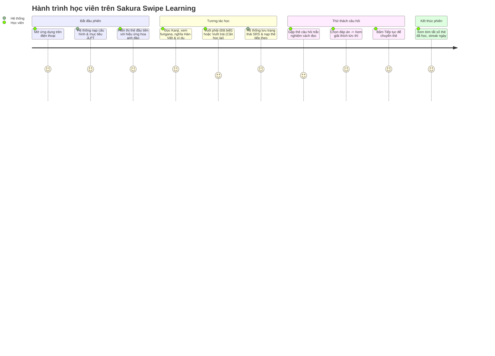

# PRD — Product Requirements Document: Sakura Swipe Learning

## 1. Tổng Quan & Tầm Nhìn Sản Phẩm

**Sakura Swipe Learning** là nền tảng học tiếng Nhật đa nền tảng (Mobile-first Web / PWA) ứng dụng định dạng "bảng tin thẻ vuốt dọc" tương tự mạng xã hội video ngắn, kết hợp với phương pháp Lặp lại ngắt quãng (Spaced Repetition System - SRS) và bài tập thực hành tương tác ngay trên thẻ học.

Mục tiêu chính:

- Biến thời gian "chết" mỗi ngày (trên xe bus, giờ nghỉ giải lao) thành các phiên học tiếng Nhật tập trung và cuốn hút.
- Giúp người học làm quen và ghi nhớ Kanji, Từ vựng, Ngữ pháp từ cấp độ N5 đến N1 theo lộ trình cá nhân hóa.
- Tạo cảm giác tiến bộ liên tục thông qua gamification (EXP, Streak, cấp độ danh hiệu) và phản hồi tức thì.

---

## 2. Phân Tích Phạm Vi: MVP vs. Giai Đoạn Tiếp Theo

### 2.1. Phạm vi MVP (Phase 0 – Phase 3 & 4 Cốt lõi)

- **Nội dung học**:
  - Tập trung trọn vẹn vào **Kanji** (N5, N4) và mở rộng cho **Từ vựng** N5.
  - Hỗ trợ đầy đủ Furigana, âm Hán-Việt, âm On/Kun, số nét, ví dụ song ngữ Nhật - Việt.
- **Trải nghiệm vuốt**:
  - Vuốt dọc: Lên (chuyển sang thẻ tiếp theo), Xuống (quay lại thẻ trước nếu còn trong lịch sử phiên).
  - Vuốt ngang: Phải (Đã biết / Tự đánh giá nhớ tốt), Trái (Học lại / Cần củng cố sớm).
  - Nút bấm trợ năng tương đương trên giao diện cho mọi thao tác cử chỉ.
- **Dạng câu hỏi MVP**:
  - Trắc nghiệm 4 lựa chọn A/B/C/D (Kanji → cách đọc hiragana, Kanji → nghĩa Hán Việt / Việt, Từ vựng → nghĩa).
  - Điền đáp án hiragana (nhập cách đọc cho Kanji/Từ vựng, chấp nhận nhiều biến thể đáp án).
- **Thuật toán Feed (SRS cơ bản)**: Tỷ lệ phân phối 60% Thẻ mới, 30% Thẻ cần ôn tập, 10% Câu hỏi kiểm tra.
- **Quản lý người dùng & Tiến trình**:
  - Đăng ký, Đăng nhập (JWT), Lưu mục tiêu JLPT.
  - Lưu trạng thái từng thẻ (New, Learning, Review Due, Mastered) và lịch sử thao tác với Idempotency chống ghi trùng.
- **Trang Admin tối giản**: Xem danh sách nội dung, thêm/sửa Kanji và xem số lượng thống kê cơ bản.

### 2.2. Giai đoạn tiếp theo (Post-MVP / Full Vision)

- Toàn bộ nội dung Ngữ pháp, Mẫu câu, Hội thoại N3–N1.
- Dạng câu hỏi nâng cao: Ghép mảnh câu (drag & drop / tap to order), phân tích bộ thủ Kanji chuyên sâu.
- Luyện nghe (Audio phát âm tự nhiên hoặc TTS giọng chuẩn Tokyo) và luyện đọc đoạn văn.
- Hỗ trợ PWA hoàn chỉnh, lưu trữ IndexedDB và đồng bộ Offline-First hai chiều khi mất mạng.
- Phân quyền Admin đa cấp độ, kiểm duyệt nội dung cộng đồng đóng góp (User-generated content).
- Gamification nâng cao: Bảng xếp hạng tuần, huy hiệu, streak học liên tục và chia sẻ thành tích.

---

## 3. Chân Dung Người Dùng & Hành Trình (User Personas & Journeys)

### 3.1. Chân dung người dùng (User Personas)

- **Linh (22 tuổi - Sinh viên/Người đi làm bận rộn)**: Đang ôn thi JLPT N4, có khoảng 10-15 phút rảnh rỗi trên tàu/xe buýt. Cần ứng dụng mở nhanh, vuốt nhẹ là học được ngay mà không phải thiết lập cấu hình rườm rà.
- **Quân (28 tuổi - Kỹ sư phần mềm làm việc với đối tác Nhật)**: Muốn tăng cường vốn Kanji N3-N2, thích các bài tập phản xạ nhanh, cần giải thích âm Hán Việt và cấu tạo bộ thủ.
- **Thầy Tuấn (35 tuổi - Giáo viên tiếng Nhật / Admin)**: Cần công cụ quản lý nội dung trực quan, thêm mới Kanji/Từ vựng chuẩn xác kèm ví dụ và câu hỏi kiểm tra.

### 3.2. Hành trình người dùng chính (Primary User Journey - Học viên)

---

## 4. Chi Tiết Các Loại Thẻ Kiến Thức

Mỗi thẻ hiển thị toàn màn hình theo tỷ lệ di động (tối ưu dọc 9:16 hoặc vừa vặn khung nhìn điện thoại):

1. **Thẻ Kanji**:
   - Chữ Hán lớn nổi bật, phong cách thư pháp/font chữ chuẩn Nhật (Noto Sans JP / Klee One).
   - Âm Hán Việt in đậm rõ ràng (ví dụ: **NHẬT**, **BẢN**).
   - Âm On (Onyomi) và Âm Kun (Kunyomi) kèm ví dụ thực tế.
   - Số nét, bộ thủ chính cấu tạo.
   - 2-3 câu ví dụ minh họa kèm Furigana và dịch nghĩa tiếng Việt.
2. **Thẻ Từ Vựng**:
   - Từ vựng viết bằng Kanji/Hiragana/Katakana.
   - Phiên âm Hiragana và Romaji (tùy chọn bật/tắt).
   - Phân loại từ (Danh từ, Động từ nhóm 1/2/3, Tính từ -i/-na).
   - Nghĩa tiếng Việt chính xác và sắc thái biểu cảm.
   - Câu ví dụ có ngữ cảnh sử dụng.
3. **Thẻ Ngữ Pháp**:
   - Mẫu ngữ pháp nổi bật kèm cấp độ JLPT.
   - Cấu trúc kết nối (V-te + mo ii, v.v.).
   - Ý nghĩa và lưu ý ngữ cảnh (lịch sự, thân mật, văn viết).
   - Các ví dụ so sánh tránh nhầm lẫn.
4. **Thẻ Mẫu Câu & Hội Thoại**:
   - Ngữ cảnh giao tiếp thực tế (Chào hỏi, hỏi đường, phỏng vấn, công sở).
   - Đoạn thoại song ngữ có hiển thị vai nói A / B.

---

## 5. Hệ Thống Câu Hỏi & Quy Tắc Chấm Điểm

| Dạng câu hỏi                    | Dữ liệu đầu vào                              | Thao tác người dùng                    | Quy tắc kiểm tra & Chấm điểm                                                                                             |
| :------------------------------ | :------------------------------------------- | :------------------------------------- | :----------------------------------------------------------------------------------------------------------------------- |
| **Trắc nghiệm A/B/C/D**         | Câu hỏi + 4 lựa chọn (1 đúng, 3 distractors) | Chạm chọn 1 đáp án                     | Đối chiếu ID đáp án được chọn với correctOptionId.                                                                       |
| **Điền cách đọc / Hiragana**    | Chữ Kanji hoặc Từ vựng                       | Nhập text từ bàn phím                  | Chuẩn hóa chuỗi (trim, lowercase, chuyển nửa độ dài/toàn độ dài). Chấp nhận nếu nằm trong danh sách `acceptableAnswers`. |
| **Nghĩa tiếng Việt → Kanji/Từ** | Nghĩa tiếng Việt                             | Chọn trong 4 phương án tiếng Nhật      | So khớp ID lựa chọn.                                                                                                     |
| **Ghép câu (Sắp xếp từ)**       | Danh sách các mảnh từ bị xáo trộn            | Chạm theo thứ tự để tạo câu hoàn chỉnh | So sánh mảng thứ tự chọn với mảng index chuẩn xác.                                                                       |
| **Điền khuyết câu ví dụ**       | Câu văn có chỗ trống `___`                   | Chọn từ thích hợp điền vào             | Kiểm tra đáp án chính xác.                                                                                               |

_Lưu ý quan trọng:_ Đối với các câu hỏi tự luận nhập văn bản, hệ thống **không áp đặt duy nhất một chuỗi cứng**, mà lưu danh sách các đáp án hợp lệ (ví dụ cho phép viết cả hiragana hoặc romaji nếu được cấu hình mở rộng).

---

## 6. Quy Tắc Tương Tác & Trợ Năng (Gestures & Accessibility)

- **Cử chỉ Vuốt dọc (Vertical Swipe)**:
  - Ngưỡng vuốt (Threshold): Di chuyển tối thiểu 50px hoặc vận tốc vuốt > 0.5px/ms.
  - Vuốt lên: Trượt thẻ hiện tại lên trên, hiển thị thẻ tiếp theo trong hàng đợi.
  - Vuốt xuống: Trượt ngược lại thẻ trước nếu còn trong lịch sử phiên học.
- **Cử chỉ Vuốt ngang (Horizontal Swipe)**:
  - Áp dụng trên Thẻ Kiến Thức.
  - Vuốt sang phải: Kích hoạt nhãn "Đã thuộc / Đã biết", viền thẻ chuyển hiệu ứng xanh ngọc (Emerald), đánh dấu SRS tăng interval.
  - Vuốt sang trái: Kích hoạt nhãn "Cần học lại / Khó", viền thẻ chuyển hiệu ứng cam/đỏ hoa anh đào đậm, đánh dấu SRS ưu tiên lặp lại sớm.
- **Thẻ Câu hỏi (Question Cards)**:
  - Khóa cử chỉ vuốt ngang cho đến khi người dùng đã nộp đáp án.
  - Sau khi chọn đáp án, hiển thị ngay hộp phản hồi (Đúng: Xanh, Sai: Đỏ kèm giải thích chi tiết).
  - Xuất hiện nút "Tiếp tục" rõ ràng để chuyển sang thẻ tiếp theo.
- **Hỗ trợ Trợ Năng (Accessibility)**:
  - Dưới chân màn hình luôn có thanh điều khiển phụ (Toolbar) gồm các nút bấm:
    - ⬅️ _Trước_ | ❌ _Chưa thuộc_ | 💡 _Gợi ý/Chi tiết_ | ✅ _Đã nhớ_ | ➡️ _Kế tiếp_
  - Hỗ trợ đầy đủ phím tắt bàn phím cho Desktop: Phím mũi tên Lên/Xuống/Trái/Phải và phím cách (Space).

---

## 7. Phân Cấp JLPT (N5 - N1) & Định Tuyến Nội Dung

Hệ thống phân chia kho dữ liệu theo 5 cấp độ chuẩn JLPT:

- **N5 (Sơ cấp 1)**: ~100 Kanji, ~800 Từ vựng, các cấu trúc ngữ pháp cơ bản (Desu, Masu, trợ từ wa, ga, o, ni, de...).
- **N4 (Sơ cấp 2)**: ~180 Kanji, ~1,500 Từ vựng, thể Te, thể Khả năng, Câu điều kiện (tara, ba, to...).
- **N3 (Trung cấp)**: ~370 Kanji, ~3,750 Từ vựng, cấu trúc diễn đạt tự nhiên, kính ngữ cơ bản.
- **N2 (Trung-Cao cấp)**: ~400 Kanji, ~6,000 Từ vựng, văn phong tin tức, công sở, thương mại.
- **N1 (Cao cấp)**: ~1,200 Kanji còn lại, văn phong nghị luận, thành ngữ, sắc thái tinh tế.

**Quy tắc định tuyến nội dung:**

- Người học chọn một mục tiêu JLPT chính (`target_jlpt`).
- Khi học, feed ưu tiên cấp độ mục tiêu đã chọn. Người học có thể mở rộng học đồng thời hoặc chuyển đổi cấp độ linh hoạt bất cứ lúc nào.

---

## 8. Cấp Độ Người Dùng (User Level) & Tiến Trình Học Tập

Hệ thống phân biệt rõ 3 khái niệm:

1. **JLPT Mục Tiêu**: Cấp độ kiến thức người dùng đang ôn luyện (N5, N4, N3, N2, N1).
2. **User Level & EXP**: Cấp độ trải nghiệm người dùng trong ứng dụng. Mỗi lần vuốt học thẻ nhận +5 EXP, trả lời đúng câu hỏi nhận +10 EXP. Điểm EXP tích lũy giúp tăng cấp bậc (Cánh hoa -> Nụ hoa -> Hoa nở rực rỡ).
3. **Mức Độ Thành Thạo Kiến Thức (SRS Mastery Stage)**:
   - **Giai đoạn 0 (Mới - New)**: Chưa từng học.
   - **Giai đoạn 1 - 2 (Đang học - Apprentice)**: Khoảng cách ôn tập: 4 giờ -> 8 giờ.
   - **Giai đoạn 3 - 4 (Thành thạo - Guru)**: Khoảng cách ôn tập: 1 ngày -> 3 ngày.
   - **Giai đoạn 5 - 6 (Nắm vững - Master)**: Khoảng cách ôn tập: 1 tuần -> 2 tuần.
   - **Giai đoạn 7 - 8 (Khắc sâu - Enlightened / Burned)**: Khoảng cách ôn tập: 1 tháng -> 4 tháng.

---

## 9. Tiêu Chí Nghiệm Thu Cụ Thể (Acceptance Criteria)

- **AC-01 (Vuốt dọc mượt mà)**: Người dùng có thể vuốt lên để chuyển thẻ tiếp theo với độ trễ < 100ms; vuốt xuống quay lại thẻ trước mà không làm mất trạng thái.
- **AC-02 (Vuốt ngang ghi nhận SRS)**: Vuốt phải hiển thị huy hiệu "Đã biết" màu xanh; vuốt trái hiển thị huy hiệu "Cần học lại" màu cam; dữ liệu được gửi về backend và phản hồi thành công.
- **AC-03 (Chống gian lận thẻ câu hỏi)**: Không thể vuốt bỏ qua thẻ câu hỏi nếu chưa nộp câu trả lời; sau khi nộp, hiển thị kết quả đúng/sai kèm giải thích chi tiết trong vòng 200ms.
- **AC-04 (Hỗ trợ nút bấm trợ năng)**: Người dùng bấm các nút ⬅️, ❌, ✅, ➡️ trên thanh điều khiển cho kết quả tương đương 100% với thao tác vuốt cảm ứng.
- **AC-05 (Chống trùng lặp tiến trình)**: Khi client thử lại gửi cùng một `clientEventId`, hệ thống trả về mã 200 thành công mà không cộng dồn thêm EXP hay sai lệch lịch ôn tập.
