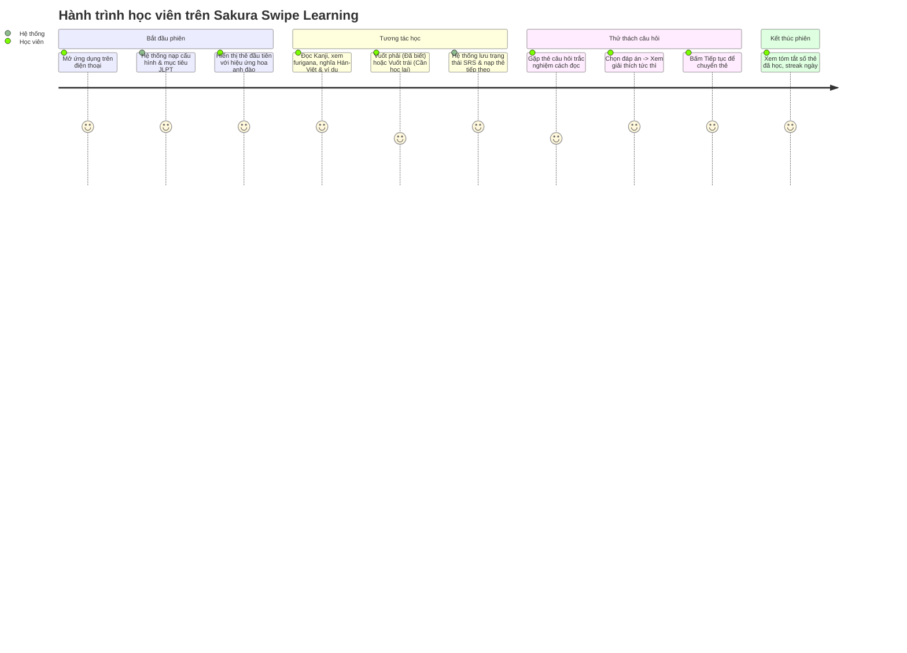

# PRD — Product Requirements Document: Sakura Swipe Learning

## 1. Tổng Quan & Tầm Nhìn Sản Phẩm

**Sakura Swipe Learning** là nền tảng học tiếng Nhật đa nền tảng (Mobile-first Web / PWA) ứng dụng định dạng "bảng tin thẻ vuốt dọc" tương tự mạng xã hội video ngắn, kết hợp với phương pháp Lặp lại ngắt quãng (Spaced Repetition System - SRS) và bài tập thực hành tương tác ngay trên thẻ học.

Mục tiêu chính:
- Biến thời gian "chết" mỗi ngày (trên xe bus, giờ nghỉ giải lao) thành các phiên học tiếng Nhật tập trung và cuốn hút.
- Giúp người học làm quen và ghi nhớ Kanji, Từ vựng, Ngữ pháp từ cấp độ N5 đến N1 theo lộ trình cá nhân hóa.

---

## 2. Phân Tích Phạm Vi: MVP vs. Giai Đoạn Tiếp Theo

### 2.1. Phạm vi MVP (Phase 0 – Phase 3 & 4 Cốt lõi)
- **Nội dung học**: Tập trung trọn vẹn vào **Kanji** (N5, N4) và mở rộng cho **Từ vựng** N5.
- **Trải nghiệm vuốt**:
  - Vuốt dọc (lên: thẻ tiếp theo, xuống: thẻ trước trong lịch sử phiên).
  - Vuốt ngang trên thẻ kiến thức (phải: Đã biết, trái: Cần học lại).
  - Nút bấm trợ năng tương đương trên giao diện cho mọi thao tác cử chỉ.
- **Dạng câu hỏi MVP**:
  - Trắc nghiệm A/B/C/D (Kanji → cách đọc, Kanji → nghĩa Hán Việt / Việt, Từ vựng → nghĩa).
  - Điền đáp án hiragana (nhập cách đọc cho Kanji/Từ vựng, chấp nhận nhiều biến thể đáp án).
- **Thuật toán Feed (SRS cơ bản)**: Tỷ lệ phân phối 60% Thẻ mới, 30% Thẻ cần ôn tập, 10% Câu hỏi kiểm tra.
- **Quản lý người dùng**: Đăng ký, Đăng nhập (JWT), lưu lịch sử học tập và trạng thái thẻ (Đã biết, Cần học lại, Đang học).
- **Trang Admin tối giản**: Xem danh sách nội dung, thêm/sửa Kanji và xem số lượng thống kê cơ bản.

### 2.2. Giai đoạn tiếp theo (Post-MVP / Full Vision)
- Toàn bộ nội dung Ngữ pháp, Mẫu câu, Hội thoại N3–N1.
- Dạng câu hỏi nâng cao: Ghép mảnh câu (drag & drop / tap to order), phân tích bộ thủ Kanji chuyên sâu.
- Luyện nghe (Audio phát âm tự nhiên hoặc TTS giọng chuẩn Tokyo) và luyện đọc đoạn văn.
- Hỗ trợ PWA hoàn chỉnh, lưu trữ IndexedDB và đồng bộ Offline-First hai chiều khi mất mạng.
- Phân quyền Admin đa cấp độ, kiểm duyệt nội dung cộng đồng đóng góp (User-generated content).
- Gamification nâng cao: Bảng xếp hạng tuần, huy hiệu, streak học liên tục và chia sẻ thành tích.

---

## 3. Chân Dung Người Dùng & Hành Trình (User Journeys)

### 3.1. Chân dung người dùng (User Personas)
- **Linh (22 tuổi - Sinh viên/Người đi làm bận rộn)**: Đang ôn thi JLPT N4, có khoảng 10-15 phút rảnh rỗi trên tàu/xe buýt. Cần ứng dụng mở nhanh, vuốt nhẹ là học được ngay mà không phải thiết lập cấu hình rườm rà.
- **Quân (28 tuổi - Kỹ sư phần mềm làm việc với đối tác Nhật)**: Muốn tăng cường vốn Kanji N3-N2, thích các bài tập phản xạ nhanh, cần giải thích âm Hán Việt và cấu tạo bộ thủ.
- **Admin / Giáo viên tiếng Nhật**: Cần công cụ quản lý nội dung trực quan, thêm mới Kanji/Từ vựng chuẩn xác kèm ví dụ và câu hỏi kiểm tra.

### 3.2. Hành trình người dùng chính (Primary User Journey - Học viên)

---

## 4. Chi Tiết Các Loại Thẻ Kiến Thức

Mỗi thẻ hiển thị toàn màn hình theo tỷ lệ di động (tối ưu dọc 9:16 hoặc vừa vặn khung nhìn điện thoại):

1. **Thẻ Kanji**:
   - Chữ Hán lớn nổi bật, phong cách thư pháp/font chữ chuẩn Nhật (Noto Sans JP / Klee One).
   - Âm Hán Việt in đậm rõ ràng (ví dụ: **NHẬT**, **BẢN**).
   - Âm On (Onyomi) và Âm Kun (Kunyomi) kèm ví dụ thực tế.
   - Số nét, bộ thủ chính cấu tạo.
   - 2-3 câu ví dụ minh họa kèm Furigana và dịch nghĩa tiếng Việt.
2. **Thẻ Từ Vựng**:
   - Từ vựng viết bằng Kanji/Hiragana/Katakana.
   - Phiên âm Hiragana và Romaji (tùy chọn bật/tắt).
   - Phân loại từ (Danh từ, Động từ nhóm 1/2/3, Tính từ -i/-na).
   - Nghĩa tiếng Việt chính xác và sắc thái biểu cảm.
   - Câu ví dụ có ngữ cảnh sử dụng.
3. **Thẻ Ngữ Pháp**:
   - Mẫu ngữ pháp nổi bật kèm cấp độ JLPT.
   - Cấu trúc kết nối (V-te + mo ii, v.v.).
   - Ý nghĩa và lưu ý ngữ cảnh (lịch sự, thân mật, văn viết).
   - Các ví dụ so sánh tránh nhầm lẫn.
4. **Thẻ Mẫu Câu & Hội Thoại**:
   - Ngữ cảnh giao tiếp thực tế (Chào hỏi, hỏi đường, phỏng vấn, công sở).
   - Đoạn thoại song ngữ có hiển thị vai nói A / B.

---

## 5. Hệ Thống Câu Hỏi & Quy Tắc Chấm Điểm

| Dạng câu hỏi | Dữ liệu đầu vào | Thao tác người dùng | Quy tắc kiểm tra & Chấm điểm |
| :--- | :--- | :--- | :--- |
| **Trắc nghiệm A/B/C/D** | Câu hỏi + 4 lựa chọn (1 đúng, 3 distractors) | Chạm chọn 1 đáp án | Đối chiếu ID đáp án được chọn với correctOptionId. |
| **Điền cách đọc / Hiragana** | Chữ Kanji hoặc Từ vựng | Nhập text từ bàn phím | Chuẩn hóa chuỗi (trim, lowercase, chuyển nửa độ dài/toàn độ dài). Chấp nhận nếu nằm trong danh sách `acceptableAnswers`. |
| **Nghĩa tiếng Việt → Kanji/Từ** | Nghĩa tiếng Việt | Chọn trong 4 phương án tiếng Nhật | So khớp ID lựa chọn. |
| **Ghép câu (Sắp xếp từ)** | Danh sách các mảnh từ bị xáo trộn | Chạm theo thứ tự để tạo câu hoàn chỉnh | So sánh mảng thứ tự chọn với mảng index chuẩn xác. |
| **Điền khuyết câu ví dụ** | Câu văn có chỗ trống `___` | Chọn từ thích hợp điền vào | Kiểm tra đáp án chính xác. |

*Lưu ý quan trọng:* Đối với các câu hỏi tự luận nhập văn bản, hệ thống **không áp đặt duy nhất một chuỗi cứng**, mà lưu danh sách các đáp án hợp lệ (ví dụ cho phép viết cả hiragana hoặc romaji nếu được cấu hình mở rộng).

---

## 6. Quy Tắc Tương Tác & Trợ Năng (Gestures & Accessibility)

- **Cử chỉ Vuốt dọc (Vertical Swipe)**:
  - Ngưỡng vuốt (Threshold): Di chuyển tối thiểu 50px hoặc vận tốc vuốt > 0.5px/ms.
  - Vuốt lên: Trượt thẻ hiện tại lên trên, hiển thị thẻ tiếp theo trong hàng đợi.
  - Vuốt xuống: Trượt ngược lại thẻ trước nếu còn trong lịch sử phiên học.
- **Cử chỉ Vuốt ngang (Horizontal Swipe)**:
  - Áp dụng trên Thẻ Kiến Thức.
  - Vuốt sang phải: Kích hoạt nhãn "Đã thuộc / Đã biết", viền thẻ chuyển hiệu ứng xanh ngọc (Emerald), đánh dấu SRS tăng interval.
  - Vuốt sang trái: Kích hoạt nhãn "Cần học lại / Khó", viền thẻ chuyển hiệu ứng cam/đỏ hoa anh đào đậm, đánh dấu SRS ưu tiên lặp lại sớm.
- **Thẻ Câu hỏi (Question Cards)**:
  - Khóa cử chỉ vuốt ngang cho đến khi người dùng đã nộp đáp án.
  - Sau khi chọn đáp án, hiển thị ngay hộp phản hồi (Đúng: Xanh, Sai: Đỏ kèm giải thích chi tiết).
  - Xuất hiện nút "Tiếp tục" rõ ràng để chuyển sang thẻ tiếp theo.
- **Hỗ trợ Trợ Năng (Accessibility)**:
  - Dưới chân màn hình luôn có thanh điều khiển phụ (Toolbar) gồm các nút bấm:
    - ⬅️ *Trước* | ❌ *Chưa thuộc* | 💡 *Gợi ý/Chi tiết* | ✅ *Đã nhớ* | ➡️ *Kế tiếp*
  - Hỗ trợ đầy đủ phím tắt bàn phím cho Desktop: Phím mũi tên Lên/Xuống/Trái/Phải và phím cách (Space).
