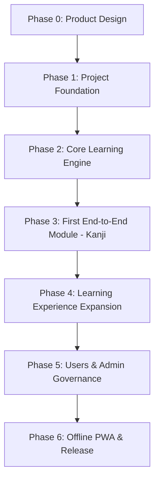

# ROADMAP — Sakura Swipe Learning Development Roadmap

Bản lộ trình này xác định thứ tự thực hiện có dependency chặt chẽ từ Phase 0 đến Phase 6 nhằm đảm bảo tiến độ vững chắc và kiến trúc không bị xáo trộn.

---

## Chi Tiết Các Giai Đoạn (Phases)

### 🌸 Phase 0 — Product Design & System Blueprint (Đang thực hiện)
- **Mục tiêu**: Hoàn thiện toàn bộ đặc tả sản phẩm (PRD), kiến trúc phân lớp (Architecture), schema cơ sở dữ liệu MySQL chuẩn hóa (Database), API contracts, bảo mật, kiểm thử và thiết lập bộ nhớ AI.
- **Dependencies**: Không.
- **Tiêu chí hoàn thành**: Toàn bộ 14 tài liệu dự án được tạo, đối soát không mâu thuẫn kỹ thuật.

### 🌸 Phase 1 — Project Foundation & Monorepo Setup
- **Mục tiêu**: Khởi tạo cấu trúc monorepo hoàn chỉnh với NPM Workspaces, cài đặt TypeScript strict mode, ESLint, Prettier, cấu hình database MySQL connection pool và test runner (Vitest).
- **Dependencies**: Hoàn thành Phase 0.
- **Deliverables**:
  - `package.json` root và packages (`apps/web`, `apps/admin`, `apps/api`, `packages/shared`).
  - Database migration script chạy thành công trên MySQL nội bộ.
  - API server khởi chạy với endpoint `/health` trả về 200 OK.

### 🌸 Phase 2 — Core Learning Engine & Data Models
- **Mục tiêu**: Thiết kế và triển khai Shared Types, DTOs, Zod Validation Schemas, thuật toán phân phối nội dung Feed và thuật toán Spaced Repetition (SRS SM-2 cải tiến).
- **Dependencies**: Hoàn thành Phase 1.
- **Deliverables**:
  - Unit test bao phủ 100% logic của `FeedEngineService` và `SrsService`.
  - Bộ schema validation cho tất cả các dạng thẻ và câu hỏi.

### 🌸 Phase 3 — First End-to-End Module (Kanji Full-Stack)
- **Mục tiêu**: Xây dựng luồng hoàn chỉnh đầu tiên từ Database -> Repository -> Service -> Controller -> Router -> Web Frontend -> Admin.
- **Dependencies**: Hoàn thành Phase 2.
- **Deliverables**:
  - CRUD Kanji API chuẩn REST.
  - Giao diện thẻ Kanji trên Web với cử chỉ vuốt dọc/ngang mượt mà và nút bấm trợ năng.
  - Trang thêm/sửa Kanji cơ bản trên Admin.
  - Integration test và Component test pass 100%.

### 🌸 Phase 4 — Learning Experience Expansion
- **Mục tiêu**: Mở rộng hệ thống nội dung sang Từ vựng (Vocabulary), Ngữ pháp (Grammar), Mẫu câu (Sentences) và Ngân hàng câu hỏi trắc nghiệm/tự luận tương tác.
- **Dependencies**: Hoàn thành Phase 3.
- **Deliverables**:
  - Động cơ câu hỏi tương tác (Question Engine) hỗ trợ 4 dạng bài tập.
  - Feed tích hợp kết hợp linh hoạt Thẻ kiến thức và Câu hỏi kiểm tra.
  - Trang thống kê tiến trình học tập (Streak, số thẻ đã thuộc, EXP).

### 🌸 Phase 5 — Users & Admin Governance
- **Mục tiêu**: Hoàn thiện hệ thống Authentication (JWT, bcrypt), User Profiles, phân quyền RBAC (User vs Admin), kiểm duyệt nội dung và công cụ import dữ liệu JLPT N5-N1.
- **Dependencies**: Hoàn thành Phase 4.
- **Deliverables**:
  - Màn hình Đăng ký, Đăng nhập, Quên mật khẩu.
  - Bộ công cụ Import/Export dữ liệu từ CSV/JSON cho giáo viên/admin.

### 🌸 Phase 6 — Offline PWA & Production Release
- **Mục tiêu**: Nâng cấp ứng dụng thành Progressive Web App (PWA), tích hợp Service Worker, bộ nhớ đệm IndexedDB cho phép học offline và đồng bộ dữ liệu khi có mạng trở lại.
- **Dependencies**: Hoàn thành Phase 5.
- **Deliverables**:
  - Ứng dụng cài đặt được trên màn hình chính của iPhone/Android (Add to Home Screen).
  - Tối ưu hóa hiệu năng Lighthouse Score >= 90.
  - Hướng dẫn triển khai Docker / Production Server hoàn chỉnh.
